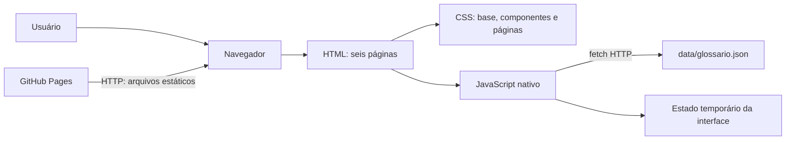

# SinalVital — Visão geral técnica

**Revisão:** 27/11/2026 · versão acadêmica implementada  
**Projeto:** SinalVital — Comunicação que Cuida  
**Instituição:** Universidade Católica de Brasília (UCB) · disciplina de Libras

## 1. Propósito e escopo

O SinalVital é uma aplicação web estática de caráter educativo, destinada principalmente a profissionais e estudantes da saúde. Apoia a comunicação com pessoas surdas por meio de orientações, exemplos visuais, consulta de termos e uma atividade simulada. A proposta interdisciplinar reúne Ciência da Computação, Biologia e Fisioterapia.

O projeto não pressupõe uma única experiência surda: a língua e as preferências de comunicação devem ser respeitadas. O protótipo não presta atendimento clínico, não gera prescrições, não traduz automaticamente para Libras e não substitui intérpretes qualificados.

## 2. Arquitetura

A solução adota uma arquitetura multipágina (MPA), com HTML, CSS, JavaScript nativo e dados JSON. Não há framework, backend de aplicação, autenticação, banco de dados, coleta de informações de pacientes ou processo de build. O GitHub Pages distribui os arquivos estáticos; a lógica interativa é executada no navegador.



O servidor HTTP local é necessário para o carregamento confiável do JSON; Python e Live Server são alternativas de execução, não dependências da aplicação. Consulte o [README](../README.md).

## 3. Estrutura de código

```text
index.html
pages/
  atendimento.html
  orientacoes.html
  glossario.html
  conhecer.html
  sobre.html
assets/
  css/
    global.css
    components.css
    editorial-wide.css
    pages/
      index.css
      site.css
      atendimento.css
      orientacoes.css
      glossario.css
      conhecer.css
      sobre.css
  js/
    navigation.js
    anamnese.js
    glossario.js
  img/                 # recursos gráficos locais
data/                  # dados estáticos
  glossario.json
docs/                  # documentação técnica
```

| Módulo | Responsabilidade |
| --- | --- |
| `global.css` | Tokens, reset, tipografia base, foco e utilitários de acessibilidade. |
| `components.css` | Cabeçalho, menu, rodapé e componentes compartilhados. |
| `editorial-wide.css` | Composição ampla, ajustes responsivos e acabamento editorial. |
| `pages/site.css` | Estilos compartilhados por páginas internas que o carregam. |
| CSS específico | Aparência e comportamento visual de cada página. |
| `navigation.js` | Menu expansível, Escape, clique externo e foco do link de salto. |
| `anamnese.js` | Cenários, alternativas, feedback e progresso da simulação. |
| `glossario.js` | Carregamento, normalização, busca, filtros, cartões, painel e mídias. |
| `glossario.json` | Fonte de dados dos verbetes. |

A modularização reduz a necessidade de modificar estilos globais ao ajustar uma página. O cabeçalho e rodapé são replicados nos HTML; mudanças estruturais nesses elementos devem ser sincronizadas entre os seis documentos.

## 4. Funcionalidades implementadas

| Página | Funcionalidade |
| --- | --- |
| Início | Banner, formulário GET de busca no Glossário, quatro caminhos ilustrados e acesso à página Conhecer. |
| Atendimento | Antes/durante/depois, atalhos contextuais e simulação de anamnese com três situações fictícias. |
| Orientações acessíveis | Comparação entre apresentação convencional e visual, exemplos de horários, duração, quantidade e cuidados; guia educativo para impressão. |
| Glossário | Seis termos em três categorias, pesquisa por prefixo, filtros, navegação horizontal manual e painel superior de consulta. |
| Conhecer | Introdução à Libras, diversidade surda, autonomia e referência ao INES. |
| Sobre | Problema, proposta, áreas da equipe, contexto acadêmico, limites e referências legais. |

### Simulação

O estado é mantido em memória (`pos`, `answered`). O botão Iniciar simulação substitui a apresentação do caso pelo painel interativo. Cada situação apresenta três alternativas; após a escolha, as opções são desabilitadas, é exibido feedback textual e a próxima etapa é habilitada. Ao concluir, há mensagem educativa e possibilidade de recomeçar. Não existe pontuação persistente, cadastro ou avaliação clínica.

### Impressão

O guia de Orientações permanece oculto na visualização normal. O botão Imprimir guia aciona `window.print()`; regras `@media print` isolam o material e definem o formato A4. O navegador controla a saída para impressora ou PDF. Trata-se de um guia fixo para profissionais, não de formulário de prescrição.

### Glossário

`fetch()` carrega `data/glossario.json`. A busca normaliza caixa e acentos, tokeniza a consulta e compara prefixos de palavras do termo e das palavras-chave, sem pesquisar a definição. Para uma única letra, considera a inicial do termo; nas demais consultas, prioriza correspondências no nome. Todos os tokens precisam corresponder. O filtro de categoria é aplicado em conjunto com a busca.

Sem consulta textual, os termos são agrupados por categoria; com consulta, ficam em Termos encontrados. O painel superior apresenta definição, exemplo em português, fonte e espaço para demonstração em Libras. A seção expansível reserva configuração de mão e exemplo em Libras. A ausência de mídia é sinalizada explicitamente.

## 5. Modelo de dados

O JSON contém uma lista de objetos. Os seis verbetes atuais são Acolhimento, Anamnese, Exame de sangue, Pressão arterial, Náusea e Tontura.

| Campo | Tipo | Finalidade |
| --- | --- | --- |
| `id` | string | Identificador estável do termo. |
| `termo` | string | Nome exibido. |
| `categoria` | string | Agrupamento e filtro. |
| `definicao` | string | Explicação em português. |
| `palavrasChave` | array de strings | Sinônimos e expressões pesquisáveis. |
| `exemploAtendimento` | string | Exemplo contextual em português. |
| `fonte` | objeto | `titulo` e `url` da referência da definição. |
| `videoLibras` | objeto ou null | Demonstração do sinal. |
| `configuracaoMao` | objeto ou null | Imagem linguística complementar. |
| `exemploLibras` | objeto ou null | Demonstração contextual em Libras. |

Exemplo de estrutura (termo existente; fonte abreviada apenas neste exemplo):

```json
{
  "id": "nausea",
  "termo": "Náusea",
  "categoria": "Sintomas",
  "definicao": "Sensação de enjoo ou vontade de vomitar.",
  "palavrasChave": ["enjoo", "vomitar"],
  "exemploAtendimento": "Você está sentindo enjoo?",
  "videoLibras": null,
  "configuracaoMao": null,
  "exemploLibras": null
}
```

Para futuras mídias, o código aceita `url` ou `src`, requer `validado` e `autorizado` verdadeiros e permite `credito`. Vídeos com `tipo` igual a `local` ou `arquivo` são apresentados por um elemento `<video>`; outros são acessados por link. Imagens podem informar `alt`. Os campos de mídia dos seis verbetes atuais estão nulos: não há demonstrações linguísticas incorporadas.

## 6. Qualidade, limites e avaliação

O código incorpora HTML semântico, controles nativos, foco visível, link de salto, mensagens de status, atributos ARIA e adaptação a telas menores. O carrossel é manual e considera a preferência de movimento reduzido. A interface não depende de contas, respostas armazenadas ou informações de saúde pessoais.

A desenvolvedora relatou testes bem-sucedidos no GitHub Pages e aprovação visual das seis páginas. Isso não equivale a auditoria formal de acessibilidade, validação clínica ou linguística, nem comprovação de impacto extensionista. As referências dos verbetes são registradas no JSON; sua revisão especializada permanece uma atividade distinta dos testes de software.

## 7. Evolução e manutenção

- Produzir vídeos próprios de sinais, exemplos contextualizados e materiais de alfabeto manual com profissionais qualificados, revisão linguística, autorização de imagem e licenciamento definido.
- Ampliar o vocabulário mediante revisão das definições e referências.
- Realizar avaliação com usuários e revisão de acessibilidade, registrando resultados efetivamente obtidos.

A branch `experimento-visual` é mantida para desenvolvimento e testes; `main` será a referência estável após a integração. Não incorporar conteúdo audiovisual de terceiros sem autorização adequada. Não apresentar ilustrações artísticas como sinais reais.

## Documentos relacionados

- [Fluxo de navegação](02_fluxo-navegacao.md)
- [Identidade visual](03_identidade-visual.md)
- [README](../README.md)
