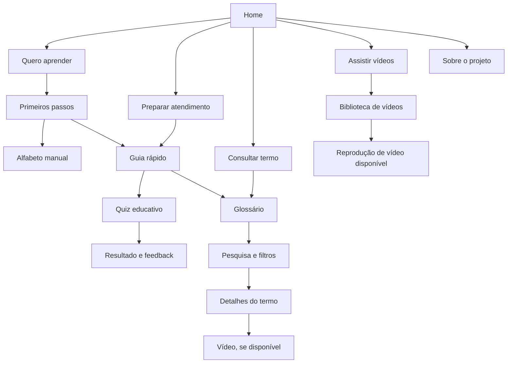

# SinalVital — Fluxo de navegação

**Estado:** arquitetura aprovada para implementação integrada; UX e comportamento em navegador devem ser testados antes da aprovação final.

## 1. Princípios

- Home em `index.html` e sete páginas independentes em `pages/`. A navegação usa links HTML, com JavaScript apenas para as interações necessárias.
- Sem login ou roteamento complexo.
- Menu global com acesso às oito áreas, indicação de localização e possibilidade de retorno à Home.
- Os quatro cartões principais identificam **necessidades do visitante**, não nomes técnicos de módulos.

## 2. Mapa da navegação

## 3. Cartões principais

| Texto do cartão | Destino inicial | Próximo passo possível |
| --- | --- | --- |
| Quero aprender | Primeiros passos | Alfabeto manual ou Guia rápido |
| Preparar atendimento | Guia rápido | Quiz ou Glossário |
| Consultar termo | Glossário | Busca, categoria, detalhes e mídia |
| Assistir vídeos | Biblioteca de vídeos | Reprodução somente de mídia existente |

## 4. Jornada de Primeiros passos e Guia rápido

**Primeiros passos:** `#primeiros-passos` → escolha livre entre três etapas (`1. Libras`, `2. Cultura surda`, `3. Comunicação acessível`). Mostrar indicador textual **Etapa X de 3** e controles **Anterior/Continuar**, com foco transferido de modo previsível ao título do novo painel. As etapas apresentam formatos complementares: revelação de informações, caso narrativo fictício de Júlia e atividade de escolha com feedback textual. Não pressupor que toda pessoa surda utiliza Libras.

**Guia rápido:** `#guia-rapido` → orientações de acolhimento → caso fictício de **anamnese** (preferência de comunicação, diálogo diretamente com o paciente, privacidade e confirmação da compreensão) → quiz educativo ou Glossário. A simulação é pedagógica, não procedimento clínico, não coleta dados de saúde e não substitui acesso a comunicação qualificada.

**Alfabeto manual:** recurso educativo complementar, ligado a Primeiros passos; não publicar demonstrações de configurações de mão sem fonte confiável e autorização.

**Sobre:** identidade acadêmica, objetivos, créditos, fontes, limitações e parcerias somente quando confirmadas.

## 5. Interações e estados

**Glossário:** mostrar termos → buscar/filtrar → selecionar termo → visualizar descrição e imagem ou vídeo existente. Se não houver resultado, informar claramente e permitir nova busca. Se faltar vídeo, exibir estado "conteúdo planejado/indisponível".

**Quiz:** iniciar → responder → receber feedback → visualizar resultado → reiniciar ou voltar. Resultado apenas em memória durante a sessão, sem armazenamento.

**Vídeos:** cards com título, categoria e disponibilidade. Apenas itens efetivamente disponíveis terão botão reproduzir habilitado; sem reprodução fictícia.

**Navegação:** menu acessível por teclado, links compreensíveis, foco visível e saída previsível de painéis. Usar caminhos relativos entre páginas e âncoras para destinos dentro do documento, como o link “Ir para o conteúdo”.

## 6. Critérios para a implementação completa

- Distribuir as oito áreas em páginas HTML e manter os quatro destinos da Home como links acionáveis com teclado.
- Menu global: apresentar todas as oito áreas diretamente ou por agrupamentos claros; não esconder destinos sem alternativa de acesso; manter retorno à Home.
- No Glossário: combinar busca normalizada com filtros, mostrar contagem, permitir limpar filtros e abrir um painel por vez sem perder o estado da busca; devolver o foco ao controle de origem quando o painel for fechado.
- Na Biblioteca: diferenciar vídeos **disponíveis**, **planejados** e **indisponíveis**; não oferecer controles de reprodução fictícios.
- No Quiz: perguntas e feedback educativo, resultado em memória, reinício e nenhuma coleta de dados pessoais.
- Usar navegação nativa entre documentos e gerenciar o foco nas interações locais. Conferir a abertura direta e a atualização de cada página no GitHub Pages.
- Testar responsividade em 320px, 375px, tablet e desktop, foco por teclado, leitores de tela quando possível e `prefers-reduced-motion`.

## 7. Questões visuais pendentes

- Validar a apresentação final do menu em desktop e celular, sem perder a arquitetura aprovada.
- Confirmar o comportamento do painel do Glossário na experiência real (no celular, exibir detalhes próximos do cartão selecionado).
- Testar animações, imagens 3D e navegação com movimento reduzido, sem depender de efeitos para compreender o conteúdo.
- Coletar feedback real sobre a clareza dos caminhos; não presumir validação por participantes antes da ação.
