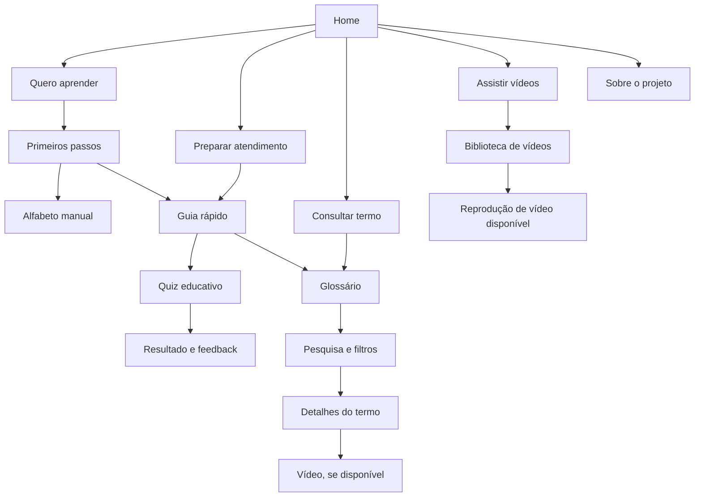

# SinalVital — Fluxo de navegação

**Estado:** proposta inicial aprovada para a estrutura; detalhes de telas sujeitos a revisão visual.

## 1. Princípios

- Um único `index.html`, com seções e navegação por links internos e JavaScript apenas quando necessário.
- Sem login ou roteamento complexo.
- Menu global com acesso às oito áreas, indicação de localização e possibilidade de retorno à Home.
- Os quatro cartões principais identificam **necessidades do visitante**, não nomes técnicos de módulos.

## 2. Mapa da navegação

## 3. Cartões principais

| Texto do cartão | Destino inicial | Próximo passo possível |
| --- | --- | --- |
| Quero aprender | Primeiros passos | Alfabeto manual ou Guia rápido |
| Preparar atendimento | Guia rápido | Quiz ou Glossário |
| Consultar termo | Glossário | Busca, categoria, detalhes e mídia |
| Assistir vídeos | Biblioteca de vídeos | Reprodução somente de mídia existente |

## 4. Interações e estados

**Glossário:** mostrar termos → buscar/filtrar → selecionar termo → visualizar descrição e imagem ou vídeo existente. Se não houver resultado, informar claramente e permitir nova busca. Se faltar vídeo, exibir estado "conteúdo planejado/indisponível".

**Quiz:** iniciar → responder → receber feedback → visualizar resultado → reiniciar ou voltar. Resultado apenas em memória durante a sessão, sem armazenamento.

**Vídeos:** cards com título, categoria e disponibilidade. Apenas itens efetivamente disponíveis terão botão reproduzir habilitado; sem reprodução fictícia.

**Navegação:** menu acessível por teclado, links compreensíveis, foco visível e saída previsível de painéis. Preferir comportamento natural de âncoras quando possível.

## 5. Questões visuais pendentes

- Como apresentar cartões e menu no desktop e celular.
- Se detalhes do glossário aparecerão num painel na mesma seção ou em um diálogo acessível.
- Composição das imagens 3D e transições (sem depender delas para compreender o conteúdo).
- Feedback de avaliação sobre clareza dos caminhos.
