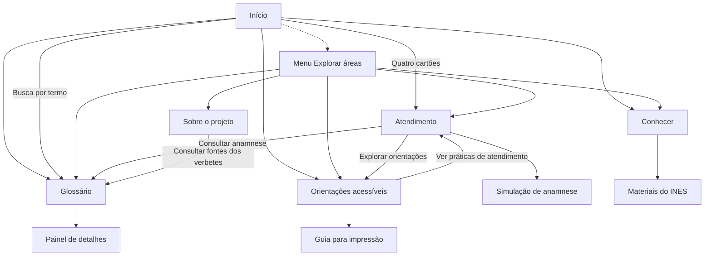
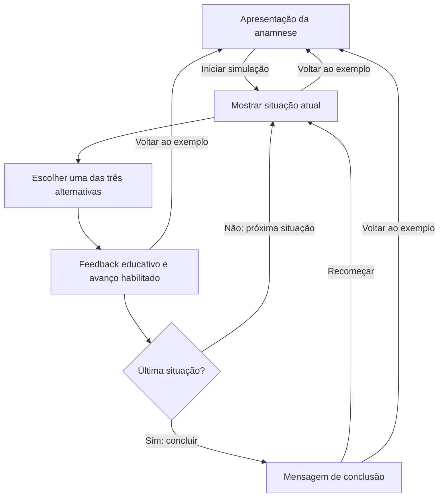
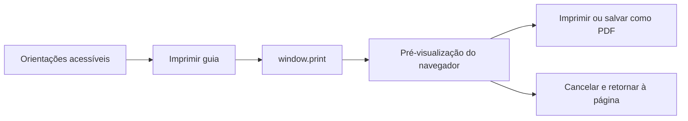
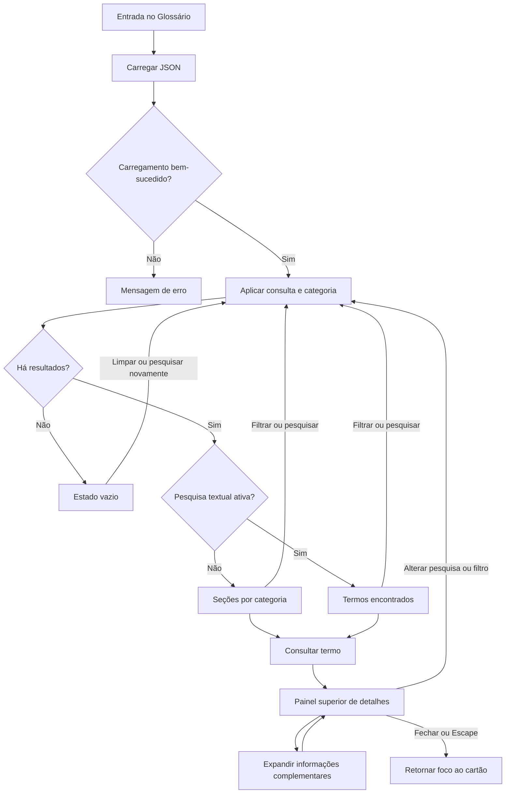

# SinalVital — Fluxo de navegação

**Revisão:** 27/11/2026 · fluxo da versão implementada  
**Relacionados:** [Visão geral](01_visao-geral.md) · [Identidade visual](03_identidade-visual.md)

## 1. Modelo de navegação

A aplicação oferece consulta não linear: o visitante escolhe uma área conforme sua necessidade, sem etapas obrigatórias de aprendizagem. O logotipo retorna à Home. O menu Explorar áreas está disponível em todas as páginas e apresenta cinco destinos internos, organizados em Atendimento, Recursos e Projeto. O rodapé fornece acesso a Sobre.

| Página | Rota |
| --- | --- |
| Início | `index.html` |
| Atendimento | `pages/atendimento.html` |
| Orientações acessíveis | `pages/orientacoes.html` |
| Glossário | `pages/glossario.html` |
| Conhecer | `pages/conhecer.html` |
| Sobre | `pages/sobre.html` |

## 2. Mapa geral — base para o Apêndice A

O diagrama destaca os principais caminhos, não uma sequência obrigatória. Por legibilidade, o menu compartilhado, o retorno à Home pelo logotipo e o link de rodapé para Sobre são representados de forma simplificada. O bloco C1 é um destino externo.

## 3. Cabeçalho e navegação compartilhada

O menu usa os elementos nativos `
` e `
`, com links HTML reais no painel. `navigation.js` atualiza o texto entre Explorar áreas e Fechar áreas, fecha o menu por Escape ou clique externo e devolve o foco ao acionador ao pressionar Escape. O link da página interna ativa possui `aria-current="page"`.

O link de salto direciona para `#conteudo` e o script posiciona o foco no elemento principal. A apresentação do menu passa de grupos em colunas para uma coluna em telas estreitas.

## 4. Início

- Banner com a mensagem central e formulário de pesquisa.
- Pesquisa enviada por GET para `pages/glossario.html?q=...`.
- Quatro cartões: Preparar atendimento, Explicar orientações, Consultar um termo e Conhecer a LIBRAS.
- Bloco sobre diferentes formas de comunicação, com link Entender melhor para Conhecer.

## 5. Atendimento — fluxo da simulação

A página apresenta os atalhos Continue consultando logo abaixo do banner, seguidos pelos cartões Antes, Durante e Depois. A seção `#anamnese` contém a apresentação do exemplo e o painel interativo, exibidos alternadamente.

As três situações são Primeiro contato, Durante a anamnese e Ao finalizar o atendimento. O progresso visual acompanha o texto de etapa. A escolha recebe feedback, independentemente de estar correta; não existe bloqueio por erro, nota ou armazenamento de respostas. Iniciar ou recomeçar reinicializa a atividade.

Atalhos: `glossario.html?termo=anamnese` e `orientacoes.html`.

## 6. Orientações acessíveis — fluxo de impressão

A leitura é livre: contexto, práticas Organize/Explique/Confirme, comparação de horários (`#comparacao`), recursos visuais (`#recursos`) e material educativo (`#modelo`). O cartão Uma orientação não é só um papel contém o link de retorno contextual para Atendimento.

O guia não é exibido integralmente na tela normal. O layout de impressão isola o conteúdo educativo e utiliza formato A4. Não há preenchimento de receita, envio de dados ou arquivo PDF pré-gerado obrigatório.

## 7. Glossário — fluxo de consulta

### Regras de interação

| Ação | Resultado |
| --- | --- |
| Entrar sem consulta | Agrupar os seis verbetes por categoria. |
| Digitar `enjoo` ou `enj` | Localizar Náusea pelas palavras-chave. |
| Digitar uma letra | Buscar apenas a inicial do nome do termo. |
| Selecionar categoria | Restringir os resultados à categoria escolhida. |
| Limpar | Apagar consulta e categoria, restaurar agrupamento e foco na busca. |
| Percorrer cartões | Rolagem horizontal manual; setas somente quando há conteúdo excedente. |
| Consultar termo | Abrir painel acima dos resultados, marcar cartão selecionado e focar título. |
| Conheça melhor o sinal | Expandir configuração de mão e exemplo em Libras. |
| Fechar detalhes / Escape | Ocultar painel e devolver foco ao cartão. |

O painel inclui categoria, termo, definição, exemplo em português e fonte. O vídeo, a configuração de mão e o exemplo em Libras têm mensagens de indisponibilidade enquanto não houver materiais próprios. O link para o Dicionário do INES abre referência externa.

Os parâmetros `q` e `termo` preenchem a consulta inicial, sem abrir automaticamente o detalhe. Alterar busca ou filtro fecha os detalhes e recalcula os resultados. O carregamento possui mensagem inicial e tratamento de falha; sem JavaScript, há aviso próprio.

## 8. Conhecer e Sobre

**Conhecer:** leitura introdutória de Libras e diversidade surda, três cartões educativos e seção de materiais linguísticos. O botão Acessar o INES leva ao portal institucional. O alfabeto manual é apresentado conceitualmente, sem biblioteca de letras ou vídeos incorporados.

**Sobre:** apresenta desafio, proposta, três áreas acadêmicas, contexto institucional, quatro limitações e base legal. O link para o Glossário permite consultar fontes individuais. As referências legais são links externos.

## 9. Verificação da navegação

A desenvolvedora informou que testou o site publicado e aprovou seu funcionamento. Para manutenção, repetir os casos abaixo após mudanças:

- Abrir todas as páginas, testar menu, logotipo, rodapé e atalhos contextuais.
- Enviar busca pela Home; testar prefixo, acentos, categoria, estado vazio, limpeza e retorno de foco.
- Percorrer as três situações da simulação, voltar e reiniciar.
- Abrir a impressão e conferir que somente o guia está presente.
- Conferir responsividade, navegação por teclado e ausência de rotas antigas.

Esses casos são roteiro de regressão, não um relatório de testes automatizados ou certificação de acessibilidade.
