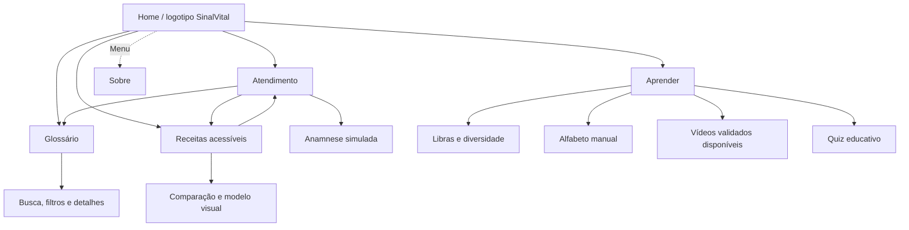

# SinalVital — Fluxo de navegação

**Versão:** 2.0 — proposta para revisão (22/11/2026)  
**Status:** especificação de UX e navegação; implementação e testes pendentes.  
**Relacionados:** `01_visao-geral.md`, `03_identidade-visual.md`.

## 1. Modelo de navegação

O SinalVital é um **guia de consulta e aprendizagem não sequencial**. O profissional deve chegar ao conteúdo pela sua necessidade, sem precisar concluir uma aula anterior. A Home apresenta quatro caminhos principais; o menu permite acesso a todas as cinco páginas internas. Os conteúdos podem se conectar por links contextuais.

**Seis páginas HTML:**

| Página | Caminho | Destino do menu |
| --- | --- | --- |
| Home | `index.html` | Acessada pelo logotipo, sem item “Início” duplicado |
| Atendimento | `pages/atendimento.html` | Atendimento |
| Receitas acessíveis | `pages/receitas.html` | Receitas acessíveis |
| Glossário | `pages/glossario.html` | Glossário |
| Aprender | `pages/aprender.html` | Aprender |
| Sobre | `pages/sobre.html` | Sobre o projeto |

As antigas páginas Primeiros passos, Guia rápido, Biblioteca de vídeos, Quiz e Alfabeto manual serão redistribuídas como **seções**, não desaparecerão como temas.

## 2. Mapa geral

As setas representam caminhos disponíveis, não sequência obrigatória.

## 3. Cabeçalho e menu expansível

**Cabeçalho fechado:** logotipo/nome à esquerda e botão **“Explorar áreas”** à direita.

**Logotipo:** link para Home com nome acessível “SinalVital — ir para a página inicial”. Na Home, o link pode retornar ao início do documento. Não exibir link visual “Início” adicional.

**Painel aberto:**

- **ATENDIMENTO:** Atendimento; Receitas acessíveis.
- **RECURSOS:** Glossário; Aprender.
- **PROJETO:** Sobre o projeto.

**Comportamentos obrigatórios:**

| Ação | Resultado |
| --- | --- |
| Acionar “Explorar áreas” | Abrir painel; `aria-expanded=true`; permitir alcançar os links |
| Acionar “Fechar áreas” | Fechar painel; `aria-expanded=false` |
| Pressionar `Escape` com painel aberto | Fechar e devolver foco ao botão de abertura |
| Selecionar destino | Navegar para a página ou seção real |
| Navegar pelo teclado | Ordem previsível, foco visível, controles nativos |
| Abrir menu no celular | Exibir as mesmas cinco opções em coluna |
| Visitar outra página | Destacar o link correspondente com `aria-current="page"` |

Usar `button` para controle e `a href` para destinos, com `aria-controls` vinculado ao painel. O fechamento por clique fora é **opcional**; não deve substituir botão ou Escape. Como o menu é uma navegação expansível comum, não atribuir `role="menu"` sem implementar o respectivo padrão de teclado.

## 4. Home — `index.html`

**Seções e links:**

| Seção / ID | Conteúdo | Ação / destino |
| --- | --- | --- |
| `#inicio` | Banner “Cuidar também é saber se comunicar.” + ilustração | “Explorar atendimento” → `pages/atendimento.html` |
| `#caminhos` | Quatro cartões grandes ilustrados | Atendimento → `pages/atendimento.html`; Receitas → `pages/receitas.html`; Glossário → `pages/glossario.html`; Aprender → `pages/aprender.html` |
| `#diversidade` | Infográfico introdutório sobre diferentes formas de comunicação | “Conhecer mais” → `pages/aprender.html#diversidade-surda` |
| `#projeto` | Resumo acadêmico e limites | “Sobre o projeto” → `pages/sobre.html` |

A Home orienta por necessidade. Não duplicar páginas completas na Home. Card inteiro pode ser um link acessível; evitar um segundo link redundante dentro do mesmo cartão.

## 5. Atendimento — `pages/atendimento.html`

| Seção / ID | Conteúdo | Interação / destino |
| --- | --- | --- |
| `#atendimento` | Contexto e ilustração | Leitura introdutória |
| `#etapas` | Antes, durante e depois do atendimento | Três blocos ou painéis acessíveis, com conteúdo visível sem animação obrigatória |
| `#anamnese` | Definição, perguntas e cuidados | “Consultar termo anamnese” → `glossario.html?termo=anamnese` |
| `#simulacao` | Caso fictício de Júlia | Cenário → 2–3 alternativas → feedback → tentar novamente |
| `#continuar` | Recursos relacionados | “Consultar glossário” → `glossario.html`; “Receitas acessíveis” → `receitas.html` |

**Simulação:** não coletar dados reais, não pontuar qualidade clínica; alternativas e feedback devem ser revisados quanto ao conteúdo educativo. Não representar que toda pessoa surda tem a mesma preferência de comunicação.

## 6. Receitas acessíveis — `pages/receitas.html`

| Seção / ID | Conteúdo | Interação / destino |
| --- | --- | --- |
| `#receitas` | Problema e finalidade educativa | Explicação curta e ilustrada |
| `#comparacao` | Orientação difícil × orientação reorganizada | Alternância ou comparação lado a lado, com texto acessível para ambos os exemplos |
| `#modelo` | Ficha demonstrativa de orientação | Campos **não preenchidos clinicamente** ou com conteúdo fictício identificado |
| `#orientacoes` | Boas práticas de explicação | Infográfico de orientações e verificação da compreensão |
| `#material` | Material complementar | Download/impressão **somente se arquivo real, revisado e disponível** |

**Restrição:** o site não é prescritor e não deve sugerir dose, tratamento, medicamento ou horários reais. O modelo complementa a prescrição e a comunicação qualificada, não as substitui. Não publicar botão de download inativo.

## 7. Glossário — `pages/glossario.html`

| Seção / ID | Conteúdo | Interação |
| --- | --- | --- |
| `#glossario` | Apresentação | Orientação breve |
| `#pesquisa` | Busca e categorias | Busca ignorando diferenças de caixa e acentos, limpar filtros |
| `#resultados` | Contagem e cartões | Selecionar termo e abrir detalhes |

**Detalhe do termo:** nome, categoria, definição, contexto de uso, fonte e ilustração pertinente. Vídeo em Libras apenas com material existente, autorizado e validado; se ausente, indicar indisponibilidade sem botão de reprodução.

**Ligação direta:** `glossario.html?termo=anamnese` deve ler o parâmetro `termo`, executar a busca e oferecer acesso ao resultado; se não encontrado, mostrar estado vazio claro. Não é obrigatório abrir automaticamente um modal.

**Estados:** carregando, sucesso, nenhum resultado, falha de carregamento. Se abrir painel/modal, gerenciar foco, Escape e retorno ao acionador; no celular, priorizar detalhe próximo ao cartão ou apresentação acessível.

## 8. Aprender — `pages/aprender.html`

| Seção / ID | Conteúdo | Interação / destino |
| --- | --- | --- |
| `#aprender` | Introdução | Breve explicação ilustrada |
| `#libras` | Libras como língua com estrutura própria | Conteúdo visual e textual introdutório |
| `#diversidade-surda` | Cultura, autonomia e preferências comunicacionais | Cartões e exemplos sem generalizações |
| `#alfabeto` | Alfabeto manual | Consulta letra a letra, somente com materiais confiáveis |
| `#videos` | Materiais audiovisuais | Acessar/reproduzir apenas quando disponíveis e autorizados |
| `#quiz` | Atividade educativa | Iniciar → responder → feedback → resultado → reiniciar |

O quiz é introdutório, não oferece certificado e não armazena respostas. O conteúdo de Libras precisa de fonte e, quando aplicável, validação linguística.

## 9. Sobre — `pages/sobre.html`

| Seção / ID | Conteúdo |
| --- | --- |
| `#sobre` | Origem e justificativa |
| `#objetivos` | Objetivos geral e específicos |
| `#equipe` | Participantes e cursos, após confirmação |
| `#metodologia` | Etapas planejadas/realizadas e avaliação |
| `#referencias` | Bibliografia, fontes, licenças e créditos |
| `#limitacoes` | Natureza educativa e limites de uso |

Não afirmar parcerias, participação comunitária ou validações ainda não realizadas.

## 10. Regras transversais

- Links HTML reais entre documentos; usar caminhos relativos conferidos em cada página.
- Todo documento terá `<main id="conteudo">` e link de salto “Ir para o conteúdo”.
- Cabeçalho e rodapé serão consistentes; atualizar os seis HTML quando um elemento compartilhado mudar.
- Teclado, foco visível, textos de controles, contraste e comportamento responsivo são requisitos de todas as páginas.
- Conteúdo não pode depender apenas de cor, ícone, animação ou ilustração.
- Respeitar `prefers-reduced-motion`; testar telas de 320 px, 375 px, tablet e desktop.
- Não criar links para arquivos, vídeos ou funcionalidades que não existem.

## 11. Critérios de aceite e decisões pendentes

**Aceite da navegação:** todas as seis páginas carregam; logotipo retorna à Home; menu abre/fecha e funciona por teclado; quatro cartões levam aos destinos corretos; âncoras e consulta direta de anamnese funcionam; nenhuma rota está quebrada; informações indisponíveis são honestamente sinalizadas.

**Pendentes de revisão:** redação final dos links; formato de painel da simulação; modelo clínico e PDF de orientação; fontes e vídeos em Libras; conteúdo do quiz; avaliação com professora surda; migração efetiva da arquitetura anterior.

Este arquivo define **o fluxo desejado**, não confirma a existência de todas as páginas ou recursos no código atual.
