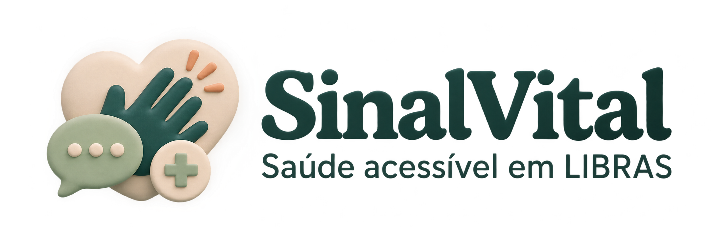

# SinalVital — Identidade visual

**Revisão:** 27/11/2026 · identidade aplicada à versão acadêmica  
**Relacionados:** [Visão geral](01_visao-geral.md) · [Fluxo de navegação](02_fluxo-navegacao.md)

## 1. Conceito visual

**SinalVital — Comunicação que Cuida** combina a temática da saúde com a comunicação acessível. A frase central, Cuidar também é saber se comunicar, sintetiza o propósito educativo.

A direção de arte combina composição editorial, títulos serifados, superfícies em tons suaves, cartões arredondados e ilustrações 3D de aparência clay. A experiência deve ser acolhedora e profissional, com informação visual útil, sem infantilizar pessoas surdas ou simular sinais de Libras com ilustrações artísticas.

## 2. Marca

| Recurso | Arquivo |
| --- | --- |
| Logotipo horizontal | `assets/img/logo-sinalvital-libras.png` |
| Ícone do navegador | `assets/img/favicon-sinalvital.png` |

O logotipo é usado no cabeçalho das seis páginas e funciona como link para a Home. O favicon também é referenciado como ícone de atalho em dispositivos compatíveis. A marca atual é um recurso PNG, não o antigo símbolo SVG provisório.

## 3. Paleta e tokens

Valores definidos em `assets/css/global.css`:

| Token | HEX | Aplicação |
| --- | --- | --- |
| `--ink` | `#143837` | Texto principal, verde-petróleo escuro. |
| `--muted` | `#3a5651` | Texto secundário. |
| `--accent` | `#146356` | Ações, links, foco e destaque. |
| `--paper` | `#fbf9f2` | Fundo marfim. |
| `--mint` | `#dceee4` | Superfícies e painéis. |
| `--line` | `#bdcfc5` | Bordas e divisórias. |
| `--lilac` | `#ece7f6` | Superfície complementar. |
| `--peach` | `#f8e9db` | Superfície complementar quente. |
| `--mist` | `#e5eff2` | Superfície complementar azulada. |
| `--surface` | `#fffdf8` | Cartões e superfícies claras. |

No Glossário, Sintomas utiliza pêssego, Exames e procedimentos utiliza azul suave e Atendimento e orientações utiliza menta. Cada categoria é também identificada por texto; a cor não é o único identificador.

Os tokens são a base compartilhada. Existem valores locais nos CSS específicos para detalhes e estados de componentes; não se trata de uma biblioteca de design independente ou de uma auditoria completa de tokens.

## 4. Tipografia e dimensionamento

| Propriedade | Valor |
| --- | --- |
| Fonte de leitura (`--font-body`) | `system-ui, sans-serif` |
| Fonte de destaque (`--font-display`) | `Georgia, "Times New Roman", serif` |
| Altura de linha base | `1.55` |
| Altura de controle base | `2.75rem` |
| Raio de painel base | `1.35rem` |
| Largura máxima base | `76rem` |
| Largura máxima editorial | `88rem` (sobrescrita em `editorial-wide.css`) |
| Raio editorial de imagem | `1.5rem`, reduzido em telas estreitas |

Títulos grandes usam escalas fluidas (`clamp()`); textos e controles privilegiam leitura direta. Não há necessidade de instalar fontes externas.

## 5. Componentes e composição

| Componente | Diretriz aplicada |
| --- | --- |
| Cabeçalho | Logo à esquerda, menu arredondado à direita, navegação em grupos. |
| Banner | Texto editorial e ilustração, com composição ampla no desktop. |
| Cartões | Bordas suaves, títulos claros, fundos variados e ícones quando úteis. |
| Ações | Botão primário destacado, secundário com contorno e links contextuais. |
| Painel de consulta | Fundo menta, definição à esquerda e espaço audiovisual à direita no desktop. |
| Simulação | Introdução ilustrada substituída pela atividade; progresso segmentado e feedback textual. |
| Comparação | Dois cartões de orientações, forma convencional e apoio visual. |
| Impressão | Guia educativo independente da composição normal da tela. |

As páginas usam HTML e CSS específicos sobre componentes compartilhados. Ícones SVG incorporados ao HTML e ilustrações locais permitem comunicação visual sem bibliotecas de ícones externas.

## 6. Direção visual por página

| Página | Composição | Recurso gráfico de referência |
| --- | --- | --- |
| Início | Banner panorâmico, busca e quatro cartões ilustrados. | `home-hero-editorial.png` |
| Atendimento | Banner, atalhos, três etapas com ícones e caso de Júlia. | `guia-saude.webp`, `anamnese-cena.webp` |
| Orientações | Contexto em duas colunas, comparação, relógios, calendário e pictogramas; CTA de impressão. | `prancheta-e-dialogo.webp` |
| Glossário | Banner compacto, pesquisa, filtros, cartões horizontais e painel superior. | `glossario-lupa.webp` |
| Conhecer | Banner, três cartões educativos e bloco de recursos com botão INES. | `cultura-surda.webp`, `alfabeto-aprendizagem.webp` |
| Sobre | Contraste entre desafio e proposta, equipe, contexto e referências em cartões. | `sobre-colaboracao.webp` |

As imagens 3D são usadas principalmente para ambientação, navegação e contextualização. Os exemplos de horários, duração e cuidados priorizam SVG, texto e elementos gráficos simples. O Glossário não apresenta ilustração conceitual no detalhe do termo: o espaço principal fica reservado à futura demonstração em Libras.

## 7. Responsividade e acessibilidade

A composição utiliza Grid, Flexbox, larguras fluidas e media queries. No desktop, textos e imagens compartilham a largura disponível; em telas menores, os blocos passam para uma coluna. O Glossário mantém rolagem horizontal localizada nos cartões, sem movimento automático. O painel de detalhes e os recursos complementares são empilhados em telas estreitas.

A base visual define foco com contorno contrastante; a busca do Glossário usa destaque no contêiner via `:focus-within`. Imagens decorativas podem usar `alt=""`; imagens informativas recebem descrição. O progresso da simulação possui equivalente textual, e as cores de categoria são acompanhadas de rótulos. O código considera a preferência de movimento reduzido no deslocamento dos cartões e em componentes compartilhados.

Essas medidas descrevem recursos de implementação. Não constituem certificação WCAG ou comprovação de contraste integral. Recomenda-se registrar testes de teclado, ampliação, leitores de tela e diferentes tamanhos de janela.

## 8. Imagens, referências criativas e materiais linguísticos

Referências de direção de arte já registradas nas versões anteriores:

- [Education Website Design Concept — Ronas IT](https://dribbble.com/shots/25272282-Education-Website-Design-Concept)
- [Nursececlub Site Rewamp — Cuberto](https://dribbble.com/shots/23467941-Nursececlub-Site-Rewamp)

Essas referências orientam composição, hierarquia e ritmo visual; não representam autorização para reproduzir materiais de terceiros. Os arquivos locais devem ter origem e condições de uso registradas antes de eventual divulgação ampliada. Este documento não comprova licenciamento individual das imagens.

A produção de sinais, alfabeto manual e exemplos em Libras fica reservada a uma etapa futura, com profissionais qualificados, revisão linguística e autorização de imagem. Ilustrações 3D, ícones e pictogramas não são demonstrações linguísticas.

## 9. Registros visuais e manutenção

A interface das seis páginas foi aprovada visualmente pela desenvolvedora após os refinamentos e o teste de publicação relatado. Para o Apêndice B, utilizar capturas da versão efetivamente publicada, com legendas identificando página e recurso. Recomenda-se registrar a Home, as três etapas e a simulação de Atendimento, a comparação e a impressão de Orientações, a busca e o detalhe do Glossário, Conhecer e Sobre.

As capturas devem mostrar o estado real do protótipo, inclusive as mensagens de indisponibilidade dos vídeos quando pertinentes. Não apresentar mídias futuras como funcionalidades concluídas. Em alterações posteriores, preservar a identidade compartilhada e atualizar este documento quando houver mudanças de tokens, componentes ou composição.
